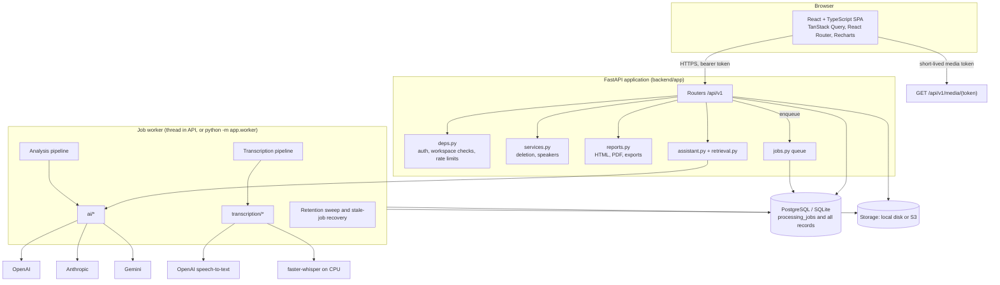

# Architecture

## Frontend (`frontend/`)

A Vite single-page app. `src/lib/api.ts` is the only place that talks to the API. It adds the bearer token, turns error bodies into `ApiError`, uploads with `XMLHttpRequest` for real progress, and downloads authenticated files as blobs. `src/lib/session.tsx` holds the signed-in user and the current workspace. Pages live in `src/pages`; shared pieces (`TranscriptViewer`, `SummaryView`, action and decision lists) are in `src/components`. Processing status is polled every 3 to 5 seconds only while a job is active. No secrets are compiled into the frontend: the only build-time variable is `VITE_API_BASE_URL`.

## Backend (`backend/app/`)

| Module | Responsibility |
|---|---|
| `main.py` | App factory, CORS, security headers, routers, embedded worker lifecycle, optional serving of a built frontend |
| `config.py` | Environment settings. Refuses to start in production without a 32+ character `SECRET_KEY` |
| `db.py`, `models.py` | SQLAlchemy 2 engine and models. SQLite gets foreign keys and WAL; PostgreSQL gets pool pre-ping |
| `security.py` | Argon2 hashing, JWT access and media tokens, reset-token hashing |
| `deps.py` | Current user (with token-version revocation), workspace role checks, in-memory rate limiter |
| `audio.py` | Magic-byte sniffing, mutagen parsing, ffmpeg conversion and chunk planning |
| `storage.py` | `LocalStorage` and `S3Storage` behind one interface, with key validation against path traversal |
| `transcription/` | Provider interface plus OpenAI and local faster-whisper adapters |
| `ai/` | Provider interface, OpenAI, Anthropic and Gemini adapters, fallback chain, strict JSON schema, analysis prompt, grounding checks |
| `jobs.py`, `worker.py` | Job queue, transcription and analysis pipelines, retries, retention |
| `retrieval.py`, `assistant.py` | Keyword retrieval and grounded question answering |
| `reports.py`, `templates/report.html` | Report data, HTML and PDF rendering, exports |
| `demo.py` | Fictional demo data |
| `routers/` | HTTP endpoints |

## Database

Alembic migrations live in `backend/alembic/versions`. Main tables: `users`, `password_reset_tokens`, `workspaces`, `workspace_members`, `projects`, `meetings`, `participants`, `recordings` (metadata and storage key only, never audio bytes), `processing_jobs`, `transcripts`, `speakers`, `transcript_segments` (`original_text` and `text`), `meeting_summaries`, `decisions`, `action_items`, `ai_conversations`, `ai_messages`, `reports` and `activity_records`. Foreign keys cascade from workspaces and meetings, so deleting a meeting or workspace removes everything derived from it. Indexes cover workspace and date lookups, job claiming and segment order.

There is no table for integration connections, because no third-party integration is implemented.

## Storage

Keys look like `recordings/{workspace}/{meeting}/{sha256-prefix}.{ext}` and `reports/{workspace}/{meeting}/{report}.pdf`. Local files are only reachable through the API: playback uses `/media/{token}` with a 15-minute token bound to the recording and user, and membership is re-checked on every request. With S3 the API hands out 15-minute pre-signed URLs for a private bucket. Files are deleted after the database commit, so a failed commit never loses files.

## Background processing

Jobs are rows in `processing_jobs`, so no Redis or broker is needed.

1. **Enqueue:** an upload, or `/transcribe` or `/analyze`, creates a `queued` job. A meeting can have only one active job (`409 job_in_progress`).
2. **Claim:** a worker runs `UPDATE ... WHERE id = ? AND status = 'queued'` and proceeds only if one row changed. This is safe with several workers.
3. **Run:** the worker updates `stage`, `progress_*` and `locked_at` between steps (heartbeat), and checks `cancel_requested` each time.
4. **Finish:** `succeeded`, or `failed` with a safe message. Retryable errors (rate limits, timeouts, 5xx) are re-queued with exponential back-off, up to `JOB_MAX_ATTEMPTS`.
5. **Recover:** jobs whose heartbeat is older than `JOB_TIMEOUT_SECONDS` are re-queued or failed by the maintenance loop, which also applies audio retention.

After a successful transcription, an analysis job is queued automatically when an AI provider is configured (`AUTO_ANALYZE`).

The worker runs as a thread inside the API (`EMBEDDED_WORKER=true`, used on Render's free plan) or as a separate process (`python -m app.worker`, used in Docker Compose). A separate worker must share storage with the API, through S3 or a shared volume.

## Transcription pipeline

The pipeline fetches a local copy of the audio. It converts the audio to 16 kHz mono MP3 when the provider does not accept the format or the file exceeds the provider's upload limit (OpenAI: 25 MB). It splits the audio into `TRANSCRIPTION_CHUNK_SECONDS` parts when needed, transcribes each part, adds the part's start offset to every timestamp and stores the segments in order. Speaker IDs are namespaced per part (`P2-A`), because providers do not keep them consistent across requests. Re-transcription replaces the earlier transcript. See [TRANSCRIPTION_GUIDE.md](TRANSCRIPTION_GUIDE.md).

## Analysis pipeline

The transcript is rendered as numbered lines (`[12] (00:03:14) Speaker 2: ...`) and sent with a strict JSON schema. Transcripts longer than `AI_MAX_INPUT_CHARS` are analysed in windows and merged, then a final call combines the partial summaries. The output then goes through `ground()`, which drops uncited decisions and actions, removes owners and deadlines missing from the cited lines, and records every change as a grounding note. Items a user edited or reviewed survive re-analysis. See [AI_ANALYSIS_GUIDE.md](AI_ANALYSIS_GUIDE.md).

## Search and retrieval

Search uses case-insensitive substring matching on PostgreSQL and SQLite, with LIKE wildcards escaped, and is always limited to one workspace. Transcript hits are ranked with a TF-IDF style score over the candidates. The assistant reuses this retrieval, adds summaries of the meetings involved (and of recent meetings for time-based questions), and adds action items and decisions when the question is about them. There are no embeddings.

## Security boundaries

- **Browser and API:** bearer tokens, CORS limited to `CORS_ORIGINS`, no cookies (so no CSRF exposure), security headers, rate limits.
- **API and data:** every query is scoped to the caller's workspace memberships. Item IDs are 128-bit random hex.
- **API and storage:** private storage, validated keys, signed short-lived links.
- **API and providers:** keys only in server environment variables. Only audio and text needed for the request are sent. Errors shown to users are generic and never include provider payloads.
- **Logs:** request paths and error types only, never transcript text, audio or keys. Third-party HTTP loggers are kept at WARNING.

See [SECURITY.md](SECURITY.md).
