# MeetPilot AI

**Turn conversations into clear outcomes.**

MeetPilot AI is a meeting intelligence platform. Upload a recording and it produces a timestamped transcript, then an AI summary, decisions and action items, each linked back to the transcript lines that support it. You can search everything, ask questions about your meetings, track tasks, and export reports.

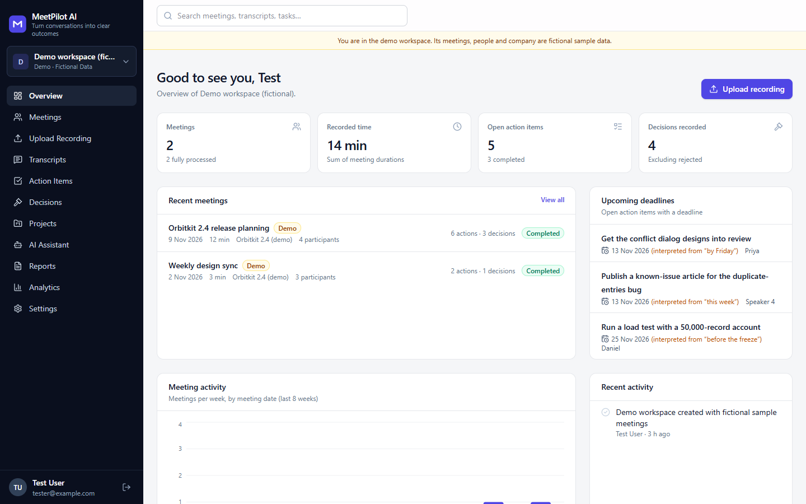

## The problem

Meetings produce decisions and commitments that are easy to lose. Notes are incomplete, and AI note-takers often fill gaps with confident guesses: an owner nobody named, a deadline nobody set. MeetPilot AI keeps every extracted item grounded. Owners and deadlines are only kept when the cited transcript lines contain them. Otherwise the item shows **Unassigned** or **No deadline specified**, and the correction is recorded.

## Key features

These are implemented and covered by automated tests unless noted.

| Area | What it does |
|---|---|
| Accounts | Registration, sign-in, sign-out, password change, password reset by email (needs SMTP), account deletion |
| Workspaces | Several workspaces per user, members with owner, admin, member and viewer roles, enforced on the server |
| Meetings | Create, edit, delete, search, filter by date, project and status, sort by date and title |
| Upload | MP3, WAV, M4A, AAC, OGG and FLAC. Content is sniffed and parsed, not trusted by extension. Size and duration limits, duplicate detection, upload progress |
| Transcription | OpenAI speech-to-text (with speaker diarisation on `gpt-4o-transcribe-diarize`) or local faster-whisper. Long files are converted and split, and parts are reassembled with correct offsets |
| Background jobs | Database-backed queue with real progress, retries with back-off, timeouts, cancellation, duplicate prevention. Runs in the API process or as a separate worker |
| Transcript viewer | Audio playback with click-to-seek, active-line highlight, search with match navigation, speaker filter, inline editing that keeps the original text, speaker renaming |
| AI analysis | Executive summary, discussion points, decisions (confirmed vs proposed vs uncertain), action items, open questions, risks, follow-ups and key dates, checked against the transcript |
| Providers | OpenAI, Anthropic Claude and Google Gemini adapters, with a primary provider and optional fallbacks |
| Action items | Edit, assign, set deadlines and priority, mark complete, add notes, filter (open, overdue, unassigned, owner, project), CSV and calendar (.ics) export |
| Decisions | Review workflow (confirm, reject, reset), filters, CSV export |
| AI assistant | Retrieves your records first, then answers only from them with clickable citations. Without an AI key it lists the matching passages instead |
| Search | Keyword search across titles, descriptions, transcripts, speaker names, action items, decisions and projects |
| Reports | PDF (Unicode fonts) and HTML reports, plus TXT, SRT, VTT, JSON, Markdown and CSV exports |
| Analytics | Meetings and minutes per week, action items created and completed, decisions by project, processing success rate, all computed from stored records |
| Privacy | Private storage, short-lived playback links, deletion of meetings, audio only, workspaces or accounts, and an optional audio retention period |
| Demo | A public read-only demo meeting (no account needed) and an optional editable demo workspace. Both are clearly labelled fictional |

**Not implemented:** live note-taking, calendar or chat integrations (Google Calendar, Outlook, Slack, Teams, Notion, Trello, Asana), and semantic (embedding) search. See the [roadmap](#roadmap).

## Screenshots

All screenshots show the fictional demo data, or a test meeting made from a synthesised voice clip.

| | |
|---|---|
| 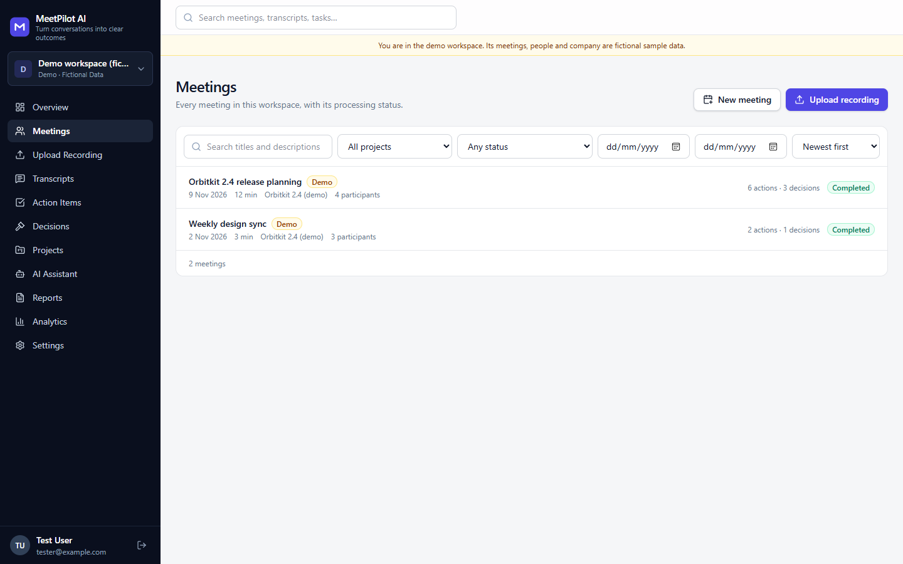 | 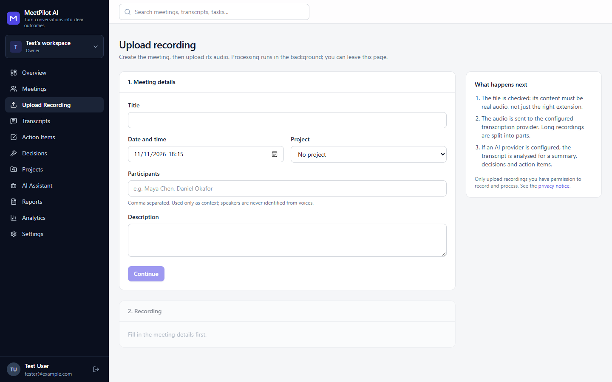 |
| Meetings list | Upload recording |
| 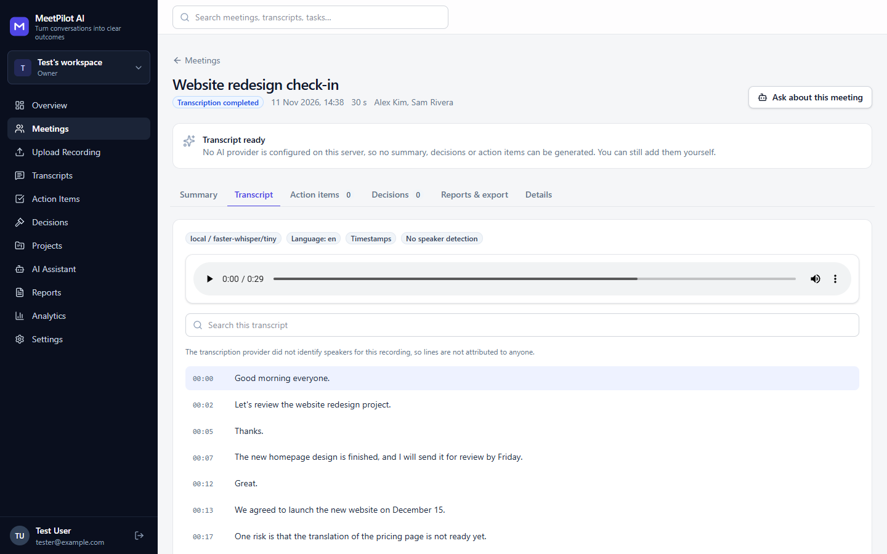 | 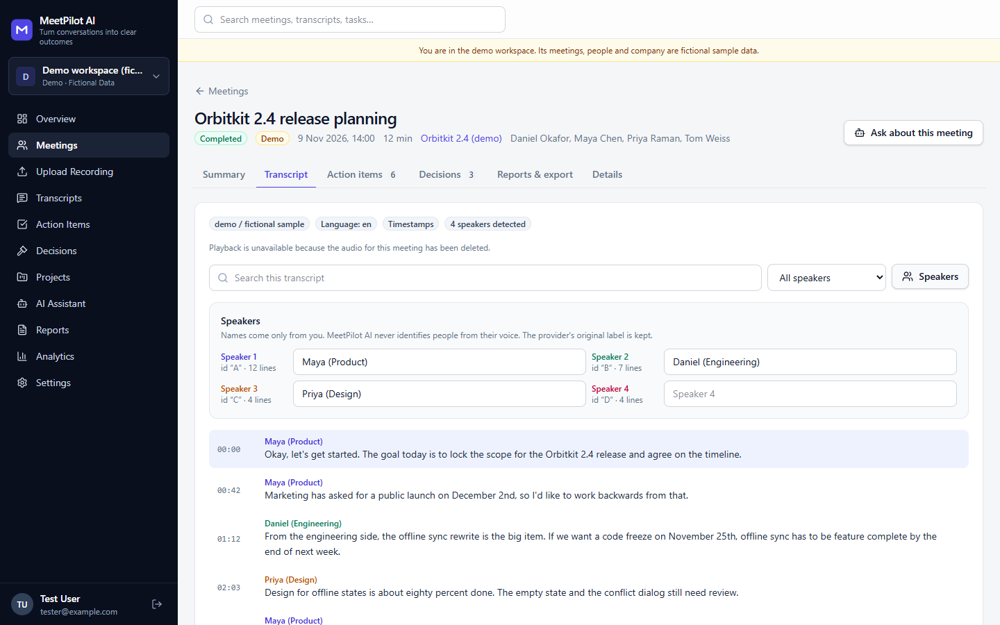 |
| Transcript with playback (real local Whisper output) | Speaker naming |
| 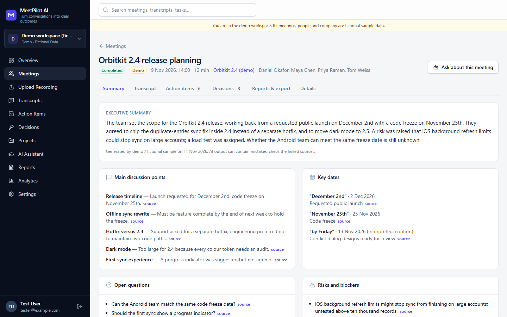 | 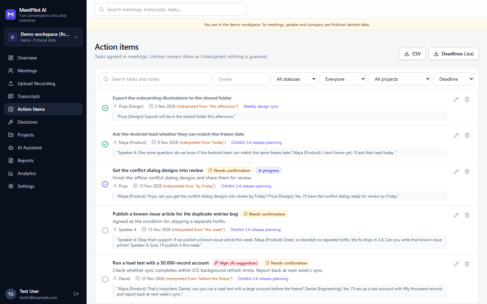 |
| Meeting summary with sources | Action items |
| 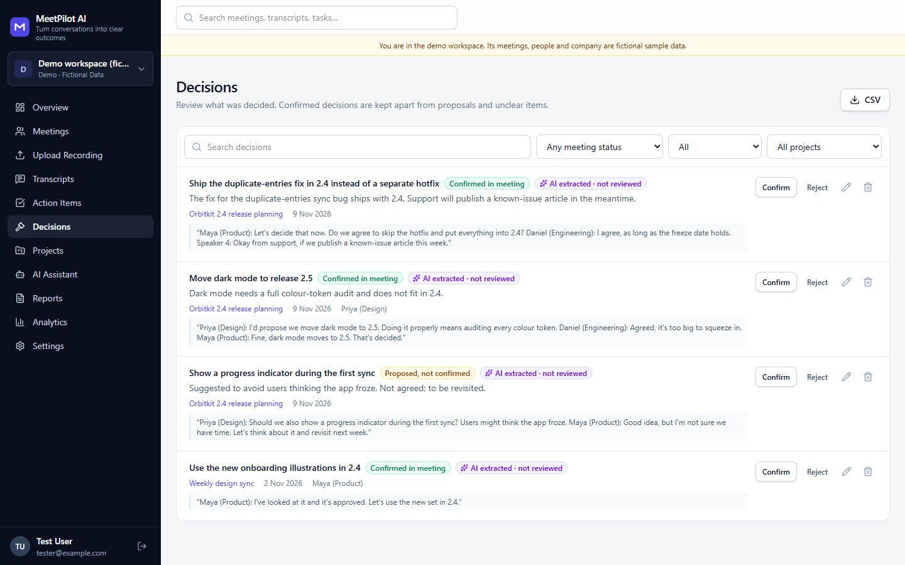 | 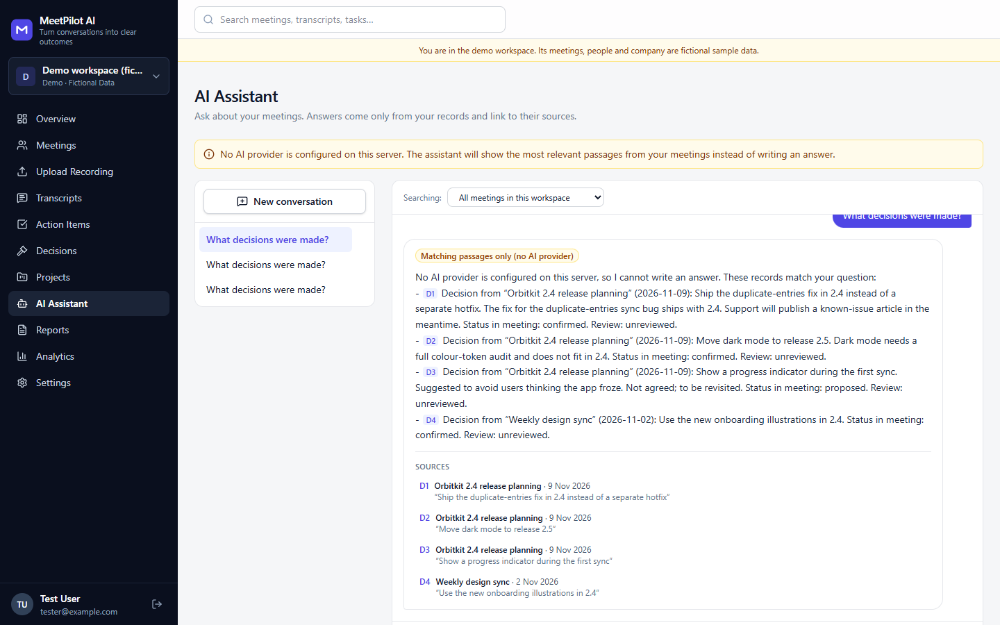 |
| Decision tracker | AI assistant (shown without an AI key: matching records only) |
| 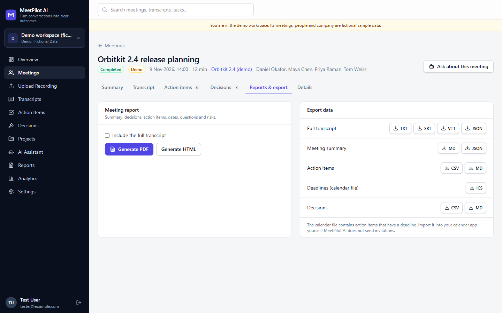 | 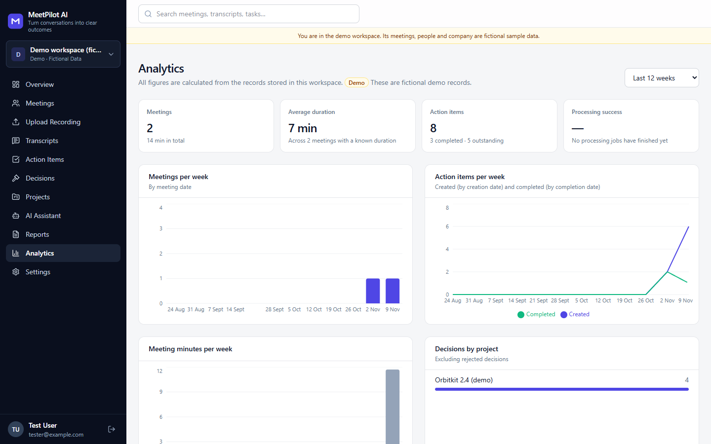 |
| Reports and exports | Analytics |

## Technology

- **Frontend:** React 19, TypeScript, Vite, Tailwind CSS 4, TanStack Query, React Router, Recharts, Lucide icons
- **Backend:** Python 3.12, FastAPI, Pydantic 2, SQLAlchemy 2, Alembic
- **Database:** PostgreSQL in production, SQLite for local development
- **Audio:** mutagen (validation and metadata), ffmpeg via imageio-ffmpeg (conversion and splitting)
- **Speech-to-text:** OpenAI audio API, or faster-whisper (CTranslate2) on the server
- **AI:** official OpenAI, Anthropic and Google Gen AI SDKs
- **Reports:** Jinja2 (HTML), ReportLab with bundled DejaVu fonts (PDF)
- **Storage:** local disk or any S3-compatible bucket

## Architecture

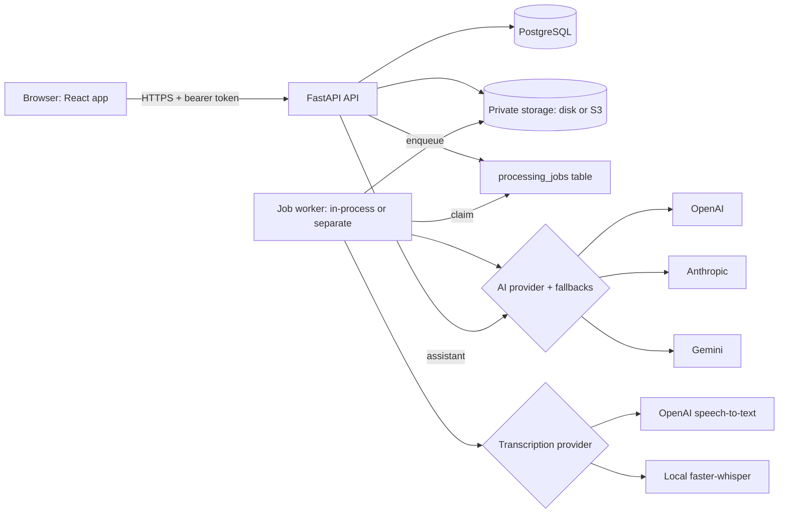

Details are in [ARCHITECTURE.md](ARCHITECTURE.md).

## Quick start (Windows or macOS)

Requirements: Python 3.11+ and Node.js 20+.

1. Download or clone the repository.
2. Double-click **`Start App.bat`** (Windows) or **`Start App.command`** (macOS; Linux users can run it from a terminal).
3. The script checks your tools, creates `.env` with a fresh `SECRET_KEY` (an existing `.env` is never overwritten), installs dependencies, migrates the database and opens http://localhost:5173.

Out of the box no provider is configured: recordings are stored but not transcribed, and no AI analysis runs. To enable them, edit `.env`:

```bash
# Free, on your computer: local Whisper (no speaker detection)
TRANSCRIPTION_PROVIDER=local
# Or OpenAI speech-to-text with speaker diarisation
TRANSCRIPTION_PROVIDER=openai
TRANSCRIPTION_API_KEY=sk-...

# AI analysis and assistant
AI_PROVIDER=anthropic        # or openai | gemini
AI_API_KEY=...
```

Then run the start script again. Full instructions, manual setup and troubleshooting are in [INSTRUCTION.md](INSTRUCTION.md).

### Docker

```bash
docker compose up --build
```

This runs PostgreSQL, the API, a separate worker and the web app on http://localhost:8088. Provider settings come from `.env`.

## Using it

- **Upload a recording:** Upload Recording, fill in the meeting details, choose the file. Processing status (queued, transcribing part 2 of 3, analysing) comes from the actual job.
- **Read and correct the transcript:** click a timestamp to play from there, edit a line (the original is kept and can be restored), and name speakers under **Speakers**.
- **Review the analysis:** every summary point, decision and action item links to its source lines. The **Grounding checks** card lists what was removed or corrected.
- **Manage action items:** click the status icon to cycle To do, In progress and Completed. Use the pencil to assign an owner, deadline, priority or notes. AI-suggested priorities are labelled as suggestions.
- **Export:** generate a PDF or HTML report, or export the transcript, summary, action items, decisions or deadlines from a meeting's **Reports & export** tab.
- **Demo:** visitors can open `/demo` without an account. Signed-in users can create a demo workspace from **Settings**.

## Configuration

All settings are environment variables. [.env.example](.env.example) lists each one with its default. Required in production: `DATABASE_URL`, `SECRET_KEY`, `CORS_ORIGINS` and `FRONTEND_URL`. Provider keys stay on the server and are never sent to the browser. See [TRANSCRIPTION_GUIDE.md](TRANSCRIPTION_GUIDE.md) and [AI_ANALYSIS_GUIDE.md](AI_ANALYSIS_GUIDE.md).

## API

REST API under `/api/v1` with bearer-token authentication, Pydantic validation, consistent `{"error": {...}}` bodies, pagination and rate limits. Interactive docs are at `/docs` in development (disabled in production). See [API_DOCUMENTATION.md](API_DOCUMENTATION.md).

## Testing

```bash
cd backend && python -m pytest          # 85 tests (SQLite)
TEST_DATABASE_URL=postgresql+psycopg://... python -m pytest   # same suite on PostgreSQL
cd frontend && npm test                 # 8 tests
```

Provider calls in the automated tests are mocked. Local Whisper transcription was tested for real; the OpenAI, Anthropic and Gemini integrations have **not** been tested against the live services, because no API keys were available. See [TESTING.md](TESTING.md).

## Security and privacy

Argon2 password hashing, signed tokens with server-side revocation, workspace checks on every request (other users' records return 404), content-sniffed uploads, private storage with short-lived playback links, rate limiting, strict CORS, security headers, and logs that never contain transcript text or keys. Read [SECURITY.md](SECURITY.md) and [PRIVACY_AND_DATA_HANDLING.md](PRIVACY_AND_DATA_HANDLING.md).

MeetPilot AI has not been audited for GDPR or any other regulation. You are responsible for having permission to record and process meetings.

## Limitations

- OpenAI, Anthropic and Gemini adapters are verified only against mocked responses.
- Local Whisper does not identify speakers. Speaker labels from OpenAI are only consistent within one request, so very long recordings split into parts may show more speakers than there were (rename them to merge).
- Rate limits are per process, not shared across several API instances.
- Search is keyword based. There is no semantic search.
- Password-reset emails need an SMTP server.
- The free Render deployment keeps its SQLite database and files on a temporary disk, so all data there is deleted whenever the service restarts or sleeps. It is a demonstration. See [RENDER_DEPLOYMENT.md](RENDER_DEPLOYMENT.md).

## Roadmap

Not built yet: calendar import (Google, Outlook) with explicit permission, task export to Trello, Asana or Notion, Slack or Teams summaries sent only on approval, semantic search with embeddings, live note-taking from the microphone, and shared rate limiting with Redis.

## Contributing

See [CONTRIBUTING.md](CONTRIBUTING.md). Report security issues as described in [SECURITY.md](SECURITY.md).

## Licence

MIT, see [LICENSE](LICENSE). Third-party components keep their own licences, see [THIRD_PARTY_NOTICES.md](THIRD_PARTY_NOTICES.md).
